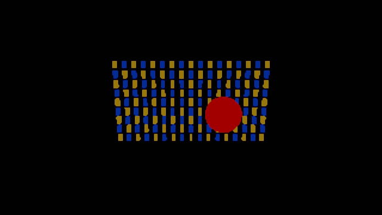

# Unity 6.3–6.7 compatibility validation

These are tests for the independent compatibility fork. This directory exists only on `codex/validation`; the package changes are on `codex/unity-6-compatibility`. No upstream PR has been submitted. Unity 6.7 support remains experimental until its stable release.

## Recorded results

Tested on 2026-10-21 using macOS ARM64, Apple M4, and Metal, with the matching built-in URP/Core packages and `ENABLE_UPSCALER_FRAMEWORK`. Unity packages and SGSR shaders were not patched.

| Editor | Compile / state checks | Image smoke checks | Settings migration | Context expiry / recreation |
|---|---|---|---|---|
| 6000.3.26f1 | Passed | 25/35 | Not applicable | Not applicable |
| 6000.4.12f1 | Passed | 25/35 | Not applicable | Not applicable |
| 6000.5.11f1 | Passed | 25/35 | Passed | Not applicable |
| 6000.6.6f1 | Passed | 25/35 | Passed | Passed |
| 6000.7.0b5 | Passed | 25/35 | Passed | Passed |

**This is not an all-green rendering result.** All ten failed image checks per Editor are the 2-pass FS variant and its Debug mode, whose RenderTexture output is nearly black. This also happens with upstream commit `ab685c993ebd0f65a762c6e28f64f124c7f12532` on Unity 6.3. The threshold is not relaxed and the test still exits with status 2. The 35 output PNGs from unmodified 6.3 and the compatibility build were byte-for-byte identical. See [matrix.json](results/matrix.json) and [the image comparison](results/6000.3-regression-comparison.json).

Spatial, 3-pass CS, Debug Spatial/3-pass, and Debug Bilinear passed. This checks nonblank image content and execution, not image quality or performance. Android, XR, and standalone Player builds have not been tested.

Some Editor versions emit a batch-mode `UnityEditor.Search.SearchDatabase` exception. The runner records that specific Editor diagnostic separately; it does not ignore rendering exceptions. Fresh templates can also emit a URP material-upgrade dialog error on the first import/run. Preserve that first log and rerun after import finishes; the recorded final runs have no other runtime errors.

## Cases

- Three upscalers and all four Debug modes.
- Two cameras rendering different output sizes with render scale 0.5.
- Output resize from 640×360 to 800×450, camera rotation cut and restoration, disabling/re-enabling the second camera, jitter off/on.
- Check the selected upscaler, actual renderer initialization, context instances, jitter settings, output resolution, and pixel variance; save screenshots.
- On Unity 6.6+, stop one camera for more than 400 frames and verify its context expires while the other camera and debug panel remain active; verify recreation when rendering resumes.
- Repeat Unity's pipeline-inspector options cleanup and verify Debug settings survive.
- On Unity 6.5+, migrate embedded Debug settings with non-default values, run options cleanup, save/reimport, and verify values and references survive.

The settings-migration check is separate from Unity's own selected-upscaler serialization. When upgrading old pipeline assets, review the selection and saved options as described in the package README.

## Reproduce on macOS

Install the desired Editor using Unity CLI. Use a **disposable project**, since the harness replaces its scene and rendering settings. The project generator extracts the installed Editor's URP template; template assets are not redistributed here.

From the repository root:

```sh
python3 'Validation~/run_validation.py' \
  --version 6000.7.0b5 \
  --project /tmp/sgsr-validation-6000.7.0b5 \
  --results /tmp/sgsr-results-6000.7.0b5
```

The script resolves the Editor path through `unity editors path`, so external-storage installations work. It creates the project when absent, runs the rendering cases, then runs the settings-migration check where applicable. Reports and complete logs remain in the chosen results directory. Re-running is supported for projects created by this tool. The expected current rendering exit code is **2**, because of the 2-pass failures above.

To install only the compatibility package in another project, use:

```text
https://github.com/kazuyaraki/com.qualcomm.snapdragon.sgsr.for.unity.git#codex/unity-6-compatibility
```

## Example output

Unity 6.7 Spatial:



Unity 6.7 2-pass FS, retaining the failed result:


